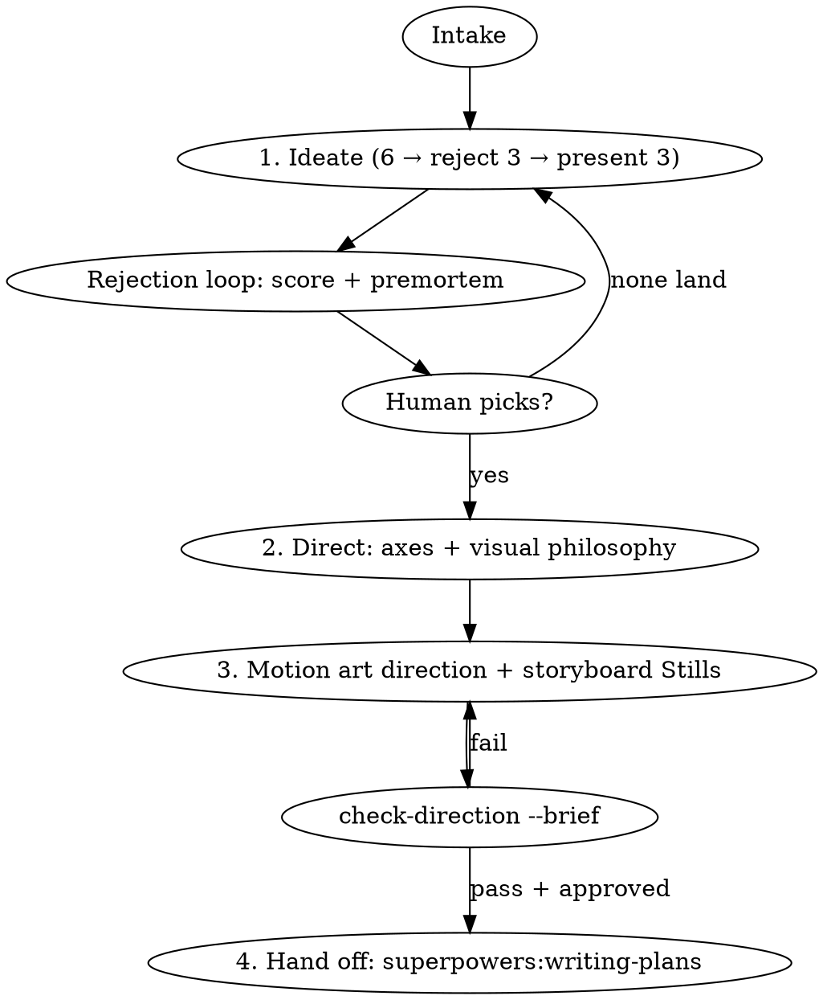

# Creative Director

## Overview

Rendering skill is not the bottleneck; taste and originality are. This skill sits **above Remotion** and runs four gated phases — Ideate → Direct → Art-direct motion → Hand off — producing one artifact, `CREATIVE.md`, that becomes the spec superpowers plans and executes against.

**Core principle:** the first idea is the average of everything you've seen. Generate past it, reject it in writing, then commit to one direction so hard that every frame obeys it.

## The Iron Law

```
NO ANIMATION CODE UNTIL CREATIVE.md IS APPROVED BY THE HUMAN
```

Approved means: Phases 1–3 filled, `node scripts/check-direction.mjs --brief CREATIVE.md` passes, and your human partner said yes to the chosen concept.

The one exception, by design: **static storyboard Stills** (Phase 3, step 7) — `<Still>` compositions with zero `interpolate`/`spring`. They are drawings, not animation.

**Violating the letter of this rule is violating its spirit.**

## When to Use

- "Make a Remotion video / promo / launch film / explainer / App Store preview"
- "Animate this", "make it feel premium", "this looks generic/cheap/busy"
- Before `superpowers:brainstorming` would hand you a vague visual spec
- Not for: fixing a render bug (use `superpowers:systematic-debugging`), tweaking one value in an already-approved piece, pure Remotion API questions

## The Flow



Copy `templates/CREATIVE.md` to the project root first. Every phase fills its section; nothing lives only in chat.

### Intake (one message)
Fill the Brief block: audience, ONE message, platform/aspect, duration, exactly 3 mood adjectives, brand cues, must-include/avoid, 1–3 references with *what to borrow*. Ask only for what's missing — max one round of questions.

### Phase 1 — Ideate
**REQUIRED:** read `references/ideation.md`. Route to a named method (de Bono PO, Oblique Strategies, SCAMPER, analogy-blending, story skeletons) — never unrouted brainstorming.
1. Generate 6 concepts privately. Write the first 3 into **Rejected (obvious)** with one line on why each is the default.
2. Present the next 3. They must differ on **at least two** of: premise, narrative structure, tone cell, visual system. Same story in three color palettes is one concept.
3. Each concept = one-line premise · the single "wow" moment · visual system · Remotion mechanism · honest failure mode. Mark one **grounded** (shippable in the stated time).

### Rejection loop (the critical addition)
Score each surviving concept 1–5 on the rubric in `references/ideation.md` (Originality via the five-test, Brief fit, One-wow clarity, Remotion feasibility, Variant survival). Run a 3-line **premortem** on the leader: "It's launch day and this flopped because…". Fix or demote. Any concept scoring ≤2 on Originality is cut regardless of total. Present scores; the human picks. If none land, switch method — never re-roll with the same one.

### Phase 2 — Creative direction + visual philosophy
**REQUIRED:** read `references/direction.md`.
4. Pick a position on the four axes (Tone register, Aesthetic philosophy, Audience relationship, Sensory ambition). Flag hard combinations.
5. Write the **visual philosophy**: a named movement (2–4 words, not a brand cliché) and one manifesto paragraph on space, form, color, type, and time. Then a **Rejection list** — concrete things this piece will never do.

### Phase 3 — Art + motion direction
**REQUIRED:** read `references/motion-language.md`.
6. Place the piece in ONE tone cell **that the 3 mood adjectives justify** — write one line mapping each adjective to calm/kinetic and soft/sharp; if any adjective contradicts the cell, change the adjective or the cell and say which. Pick ONE personality, fill the motion-language spec (one value per row), motion hierarchy, restraint list, pacing map, and per-shot direction notes. Plan variants (9:16 / 1:1 / 16:9 / store preview) now, not at render.
7. Generate `src/motion-tokens.ts` from `templates/motion-tokens.ts`. Draw 3–5 storyboard frames as Remotion `<Still>`s (hook, wow, end card) and render with `npx remotion still`. Show them.
8. Run `node scripts/check-direction.mjs --brief CREATIVE.md`. Fix every failure. Get explicit approval.

### Phase 4 — Hand off to superpowers
**REQUIRED SUB-SKILL:** `superpowers:writing-plans`, with `CREATIVE.md` as the spec. Then `superpowers:subagent-driven-development` (one shot per task; every subagent prompt includes the motion-language spec and that shot's direction notes). Read `references/remotion.md` for the spec→code contract.
**REQUIRED before claiming done:** `superpowers:verification-before-completion` — run `check-direction.mjs --code src/`, render the storyboard timestamps as stills, and compare against the approved frames.

## Express Mode (the human is in a hurry)

Hurry compresses the process; it never skips it. Instead of asking intake questions, state your Brief assumptions as a short list the human can correct. Then one message containing: 3 concepts (rejected list included), scores, a recommended pick, the filled motion spec, and a 3-frame storyboard description. One approval, then build. Faster than rewriting a generic video.

## Red Flags — STOP

| Thought | Reality |
|---|---|
| "The brief is clear, I'll just build it" | A clear brief has many valid videos. You haven't picked one yet. |
| "They said ship today" | Use Express Mode. A generic render ships nothing. |
| "Three variations of my first idea" | That's one concept. Differ on two axes. |
| "Fade-in, slide-up, logo, done" | That is the slop baseline. Reject it in writing. |
| "I'll pick easings while coding" | Easing is direction. Tokens first, code reads tokens. |
| "Spring with default config is fine" | Defaults are the un-decided choice. |
| "This one shot needs its own curve" | Log it as a NOTE with a reason, or reuse the spec. |
| "Two wow moments make it stronger" | The second cancels the first. |
| "Mood says unhurried, but stamps feel punchy — kinetic it is" | The mood adjectives are the contract. Change one or the other, out loud. |
| "Storyboards are overkill for 20s" | 3 Stills take minutes; re-animating takes hours. |

## Common Mistakes

- **Taste by adjective.** "Modern, clean, minimal" means nothing — name references, materials, mechanisms.
- **Brief drift.** `CREATIVE.md` written, then ignored. Every implementation subagent gets it in its prompt.
- **Animating everything.** Restraint list empty = direction failed.
- **Variants discovered at render.** 9:16 crops the hero off-frame. Plan safe areas in Phase 3.
- **Spec in chat only.** If it isn't in `CREATIVE.md` it doesn't exist for subagents.

## Attribution
Synthesized from: creative-ideation (SHL0MS / NousResearch Hermes, MIT), creative-direction and art-direction (rampstackco/claude-skills), motion-art-direction (iart-ai/motion-design-skills), and Anthropic's canvas-design "visual philosophy" practice.
